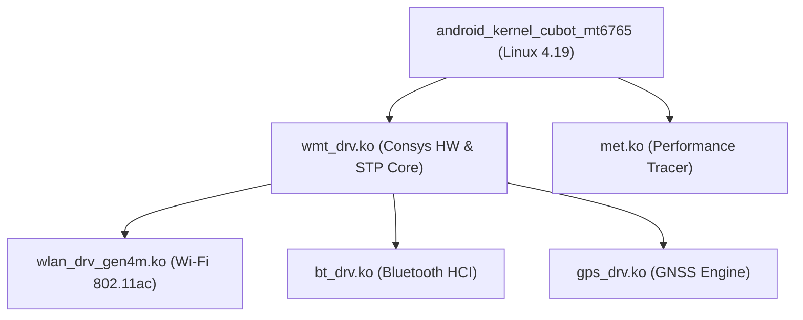

<!--
# File: README.md
# Author: kelexine <https://github.com/kelexine>
# Date: 2026-10-14
# Purpose: Documentation and build guide for Cubot P50 out-of-tree kernel modules
-->

# android_kernel_modules_cubot_mt6765

> Out-of-tree MediaTek connectivity and performance kernel modules for the Cubot P50 (marlon).

## What is this?
This repository houses the out-of-tree vendor kernel modules for the Cubot P50 smartphone (`v956` / `marlon`), powered by the MediaTek MT6765 (Helio P35 / MT6762R) architecture. It provides the full MediaTek Wireless Management Task (`wmt_drv`), Wi-Fi Gen4m (`wlan_drv_gen4m`), Bluetooth HCI (`bt_drv`), GPS / GNSS (`gps_drv`), and MediaTek Event Trace (`met`) subsystems cleanly decoupled from vendor telemetry and built against the downstream Android 4.19 kernel.

## Features
- **Wi-Fi Gen4m (MT6631/CONNAC)**: Full 2.4 GHz 40 MHz (HT40) channel bandwidth enabled by default for Station (STA) and Wi-Fi Direct (P2P), unlocking up to 150 Mbps theoretical PHY throughput for high-speed local transfers (Quick Share, LocalSend).
- **5 GHz UNII-1 Unblocked**: Restored 5 GHz non-DFS channels 36–48 with P2P Autonomous Group Owner (GO) Auto Channel Selection (ACS) for stable hotspot and direct file transfers.
- **Latency & Overhead Optimization**: Disabled AEE crash dump overhead (`CFG_SUPPORT_AEE=0`) and datapath assertion checks (`BUILD_QA_DBG=0`) to eliminate frame jitter during transient packet loss and reduce stripped binary footprint.
- **Vendor Decoupling**: Purged proprietary ColorOS telemetry hooks, project detection stubs, and empty smart bandwidth stubs to provide a lean, stable MTK connectivity stack.

## Modules Inventory
| Module | Subsystem | Function |
|---|---|---|
| `wmt_drv.ko` | Wireless Management Task | Central radio co-existence broker & hardware multiplexer |
| `wmt_chrdev_wifi.ko` | WMT Wi-Fi Char Device | Kernel-to-user character device interface |
| `wlan_drv_gen4m.ko` | Wi-Fi Gen4m Driver | 802.11a/b/g/n/ac station, AP, and P2P direct driver |
| `bt_drv.ko` | Bluetooth Driver | MediaTek Serial Transport Protocol (STP) Bluetooth HCI |
| `gps_drv.ko` | GPS / GNSS Driver | MediaTek STP GPS character device driver |
| `met.ko` | MediaTek Event Trace | Kernel event logging and CPU/GPU performance tracing |

## Building the Modules

### Workspace Layout & Required Symlinks
MediaTek connectivity Makefiles expect headers and symbols to resolve relative to `$(TOP)/vendor/...`. Organize your build directory with the modules and kernel side-by-side, and ensure the top-level `vendor` symlink is created:

```
workspace/
├── android_kernel_cubot_mt6765/          # Kernel source tree (configured with output dir)
├── android_kernel_modules_cubot_mt6765/  # This modules repository
└── vendor -> android_kernel_modules_cubot_mt6765/source/vendor
```

Create the symlink from your workspace root:
```bash
ln -sfn android_kernel_modules_cubot_mt6765/source/vendor vendor
```

### Module Build Sequence
The connectivity modules must be built against a configured and prepared kernel output tree (`KERNEL_OUT`). Because `wmt_drv` exports core symbols consumed by all other drivers, it must be compiled first:

```bash
export KERNEL_SRC="android_kernel_cubot_mt6765"
export KERNEL_OUT="out"
export MODULES_SRC="android_kernel_modules_cubot_mt6765/source"
export CONN="${MODULES_SRC}/vendor/mediatek/kernel_modules/connectivity"

# Shared toolchain flags
STD_VARS=(
    ARCH=arm64 LLVM=1 LLVM_IAS=1
    CLANG_TRIPLE=aarch64-linux-gnu- CROSS_COMPILE=aarch64-linux-gnu-
    CONFIG_MTK_PLATFORM=mt6765
    CONFIG_MTK_COMBO_CHIP='"CONSYS_6765"'
    KERNEL_OUT="${KERNEL_OUT}"
    TOP="${MODULES_SRC}"
    KCFLAGS="-Wno-error -Wno-error=strict-prototypes -Wno-strict-prototypes"
)

# 1. Build wmt_drv (exports mtk_wcn_* and connsys symbols)
make -C "${KERNEL_SRC}" O="${KERNEL_OUT}" M="${CONN}/common" "${STD_VARS[@]}" modules

# 2. Build gps_drv (depends on wmt_drv symbols)
make -C "${KERNEL_SRC}" O="${KERNEL_OUT}" M="${CONN}/gps" "${STD_VARS[@]}" \
    CONFIG_MTK_GPS_SUPPORT=y \
    KBUILD_EXTRA_SYMBOLS="${CONN}/common/Module.symvers" modules

# 3. Build bt_drv (legacy STP character driver)
make -C "${KERNEL_SRC}" O="${KERNEL_OUT}" M="${CONN}/bt/mt66xx/legacy" "${STD_VARS[@]}" \
    MODULE_NAME=bt_drv \
    KBUILD_EXTRA_SYMBOLS="${CONN}/common/Module.symvers" modules

# 4. Build wmt_chrdev_wifi
make -C "${KERNEL_SRC}" O="${KERNEL_OUT}" M="${CONN}/wlan/adaptor" "${STD_VARS[@]}" \
    MODULE_NAME=wmt_chrdev_wifi \
    KBUILD_EXTRA_SYMBOLS="${CONN}/common/Module.symvers" modules

# 5. Build wlan_drv_gen4m (chips/connac variant)
make -C "${KERNEL_SRC}" O="${KERNEL_OUT}" M="${CONN}/wlan/core/gen4m" "${STD_VARS[@]}" \
    MTK_COMBO_CHIP=CONNAC WLAN_CHIP_ID=6765 CONFIG_MTK_COMBO_WIFI_HIF=axi \
    MODULE_NAME=wlan_drv_gen4m MTK_ANDROID_WMT=y WIFI_ENABLE_GCOV=n \
    MTK_ANDROID_EMI=y MTK_WLAN_SERVICE=yes \
    KBUILD_EXTRA_SYMBOLS="${CONN}/common/Module.symvers ${CONN}/wlan/adaptor/Module.symvers" modules

# 6. Build met
make -C "${KERNEL_SRC}" O="${KERNEL_OUT}" M="${MODULES_SRC}/vendor/mediatek/kernel_modules/met_drv_v2" "${STD_VARS[@]}" modules
```

Strip module debug symbols for deployment:
```bash
llvm-strip --strip-debug ${CONN}/**/*.ko ${MODULES_SRC}/vendor/mediatek/kernel_modules/met_drv_v2/*.ko
```

## Architecture


## Contributing
- **Branch**: `marlon`
- **Commits**: Follow [Conventional Commits](https://www.conventionalcommits.org/) (`feat(wlan): ...`, `fix(wmt): ...`).
- All changes must be signed off: `Signed-off-by: Author <email>`.

## License
GPL-2.0-only
